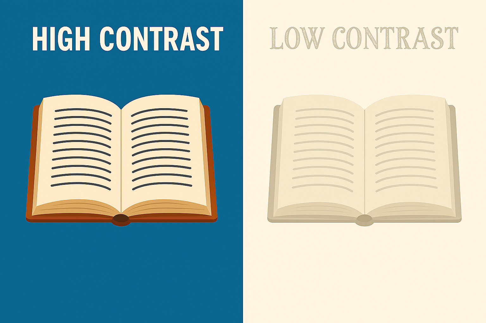

# Accessible Images

## Add Alt Text

- Alt Text is a brief description of the image.
- Alt Text is read aloud by screen readers used by visually impaired users. 
- Helps people with low or impaired vision understand the entire web page.
- Provides context to search engines and robotic scans.
- Alt Text is required for images on government-owned websites by the Americans with Disabilities Act (ADA).

### Write Good Alt Text

- Good Alt Text is copmplete and concise.
- Ask, "What would someone lose if this image didn't load?" Answer what image conveys, as well as what is present.
- Limit to 125 characters.
- Focus on what the image conveys to the user, rather than listing attributes.
- Include any words that are in the image, such as text on the cover of a book. 
- Skip redundant phrases, "image of" or "picture of."
- Include any text present in the image. 

- :white_check_mark: The Alt Text for this image is “golden retriever puppy plays with a red ball on grass in the evening.”

- :x: A bad examples of alt text would be “Dog.” “Picture of a cute dog.” or "Roger hops."

## Color and Contrast

Make sure image has enough color contrast between text and its background to be easily readable. When using text over images, add a solid background behind the text, or a dark overlay. Beware of color blindness combinations and elaborate fonts and busy visuals that can reduce visibility.

## Text in Images

Avoid using an event flier as image. Limit text to three words. Event details should be provided in the event listing itself, not in the image.

An image should work as a visual accent: use it for color and to attract attention. Use the text in title and description to communicate details. When text is included in image, make sure it is readable at thumbnail-size, which is 80px wide.

